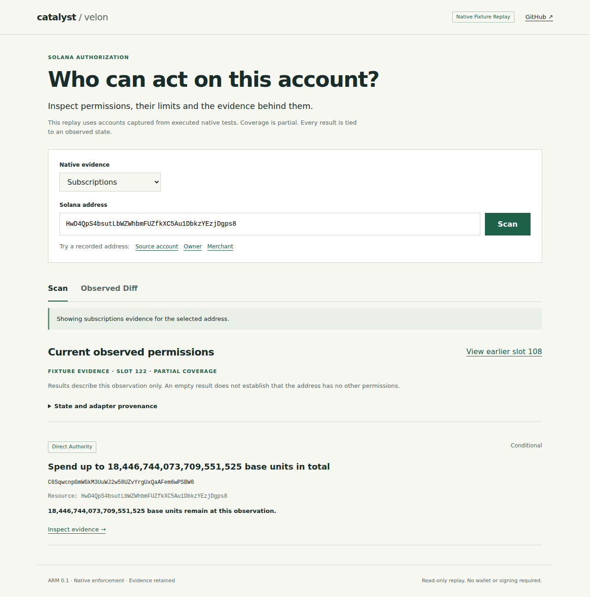

# Catalyst demo

Scan an address, inspect its native authorization and compare two observed states.
This is the Velon showcase. ARM, Cataloger and Catalyst keep their own repositories.

The demo runs the pinned Cataloger CLI, imports accounts captured by executed native
tests and serves its real journal API. The browser interprets ARM 0.1 responses.
No balances, permissions or transaction outcomes are fabricated for the interface.



## Run

Requirements: Bun 1.3.14 or newer, Node 22, npm, Git and stable Rust.

```sh
git clone https://github.com/dakewamama/cataloger.git ../cataloger
git -C ../cataloger checkout 24b8fc6b68b7cd352786c7995472dcaec9a4ab9c
npm ci --ignore-scripts
bun run demo
```

Open `http://127.0.0.1:3000`. For an existing checkout, set
`CATALOGER_DIR=/absolute/path/to/cataloger`. Its tracked files must match the pinned
revision. The first run builds `authorization-api`; later builds reuse Cargo's cache.
The local SQLite journal lives in ignored `.data/`. No RPC credential is required.
`PORT` and `RUNTIME_PORT` select the browser and observation API ports respectively.
Both bind to localhost by default. `HOST` changes only the browser server's bind address.

For bundled assets:

```sh
npm run build
bun run start
```

## What the evidence proves

Subscriptions fixtures retain two observations of the same target at slots 108
and 122. The earlier observation contains merchant/puller authority with a shared
recurring allowance. The later observation follows cancellation and delegation
revocation. That derived spend grant disappears while technical and administrative
authority remain independently observable. Select Merchant, then View earlier slot
108, to inspect the shared allowance and its parent grant.

Observed Diff compares these two whole ARM projections. It omits changing evidence
references from semantic equality while retaining the complete original records.
The interval includes several native transitions. It is not a predicted transaction
diff or proof that all changes were caused by one instruction. Different scopes,
unordered slots, failed projections and duplicate grant identities are rejected.

The SPL fixture demonstrates the same Scan and Detail views through another adapter.
Native amounts stay in integer base units. The demo does not infer a mint symbol or
decimal scale. Integers are parsed losslessly, including values above JavaScript's
safe integer range. Compound principals retain one shared grant and allowance.

Every view identifies its state version, observed slot, partial coverage, deployment,
adapter and evidence. Current means latest observed state in this fixture scope.
It does not claim complete address discovery or live freshness. Unknown, incomplete
and invalid projections suppress permissions. Derived availability remains unknown
where the generic ARM evaluator cannot prove dependencies.

## Verification

```sh
npm run format:check
npm run typecheck
npm test
npm run build
node_modules/.bin/playwright install chromium --only-shell
npm run test:e2e
```

Browser tests run against the real imported journal on desktop, tablet and mobile.
They cover shared allowances, native u64 amounts, retained administrative authority,
removed derived authority, evidence inspection, partial coverage, invalid input,
empty results, provider failure and conflicting/unsupported observations. Screenshots
and traces remain under ignored `test-results/`.

## Scope

This is a read-only native fixture replay. Live code identity is independently
verified in the SDK/runtime, but the showcased grant accounts are local executable
fixtures. Wallet execution, transaction simulation Diff, continuous indexing,
Squads, Swig and exact intent compilation are still separate milestones. No claim
is made that this repository already implements the full cross-protocol closed loop
or that no other public or private implementation exists.

Sources and reuse decisions are recorded in [SOURCE_LEDGER.md](docs/research/SOURCE_LEDGER.md).
